# COMP 3123 Assignment 1 – Backend API

A secure REST API for users and employees, built with Node.js, Express and MongoDB (Mongoose). Users sign up and log in to get a JWT, and every employee belongs to the user who created it. A user can only see and manage their own employees.

## Technologies

- Node.js 18+ and Express 5
- MongoDB with Mongoose (database `comp3123_assignment1`)
- bcryptjs (password hashing), jsonwebtoken (JWT)
- express-validator (input validation)
- Helmet (security headers), express-rate-limit (rate limiting)
- Postman collection and newman for testing, Docker Compose for local MongoDB

## Project structure

```
src/
  config/        env loading and MongoDB connection
  routes/        Express routers (mounted under /api/v1, plus /health)
  controllers/   request handlers
  models/        Mongoose schemas (User, Employee)
  middleware/    auth, validate, rateLimiter, requestLogger, errorHandler, notFound
  services/      business logic (auth.service, employee.service)
  validators/    express-validator rule sets
  utils/         logger, ApiError
  app.js         Express app (middleware + routes)
  server.js      entry point: connect DB, start server
logs/            app.log (git-ignored) and sample.log (committed example)
postman/         Postman collection and newman results
screenshots/    evidence screenshots (see screenshots/README.md)
docker-compose.yml   local MongoDB on port 27018
```

## Installation

1. Clone the repository and enter it:
   ```
   git clone <repo-url>
   cd <repo>
   ```
2. Install dependencies: `npm install`
3. Create your environment file and set a JWT secret:
   ```
   cp .env.example .env
   node -e "console.log(require('crypto').randomBytes(48).toString('hex'))"
   ```
   Paste the generated value into `JWT_SECRET` in `.env`.
4. Start MongoDB (needs Docker): `docker compose up -d`. This runs `mongo:7` as `comp3123-mongo` on port 27018, matching `MONGODB_URI` in `.env.example`.
5. Start the API: `npm run dev` (auto-reload) or `npm start`.
6. Check it is up: `curl http://localhost:3000/health`
7. Test it with the Postman collection or newman (see [Testing](#testing)).

## Configuration

All settings come from environment variables (`.env`, never committed).

| Variable | Required | Default | Purpose |
|---|---|---|---|
| `MONGODB_URI` | yes | – | MongoDB connection string. The database name is always `comp3123_assignment1`. |
| `JWT_SECRET` | yes | – | Secret used to sign and verify JWTs. Use a long random value. |
| `JWT_EXPIRES_IN` | no | `1h` | Token lifetime. |
| `PORT` | no | `3000` | HTTP port. |
| `NODE_ENV` | no | `development` | 500 responses hide the error message unless this is `development`. |
| `AUTH_RATE_LIMIT_MAX` | no | `10` | Max signup + login requests per IP per 15 minutes. |
| `API_RATE_LIMIT_MAX` | no | `100` | Max `/api/v1` requests per IP per 15 minutes. |

## API

Base path: `/api/v1`. Protected routes need `Authorization: Bearer <jwt>`.

| Method | Path | Auth | Success | Common errors |
|---|---|---|---|---|
| POST | `/api/v1/user/signup` | no | 201 | 400, 409, 429 |
| POST | `/api/v1/user/login` | no | 200 | 400, 401, 429 |
| GET | `/api/v1/emp/employees` | yes | 200 | 401 |
| POST | `/api/v1/emp/employees` | yes | 201 | 400, 401, 409 |
| GET | `/api/v1/emp/employees/{eid}` | yes | 200 | 400, 401, 403, 404 |
| PUT | `/api/v1/emp/employees/{eid}` | yes | 200 | 400, 401, 403, 404, 409 |
| DELETE | `/api/v1/emp/employees?eid=xxx` | yes | 204 (no body) | 400, 401, 403, 404 |
| GET | `/health` | no | 200 | 503 |

Success responses look like `{ "success": true, "message": "...", "data": ... }`. DELETE returns 204 with no body.

### Example: signup

```
POST /api/v1/user/signup
{ "username": "alice", "email": "alice@example.com", "password": "Passw0rd123" }
```
```
201 Created
{
  "success": true,
  "message": "User created successfully",
  "data": {
    "username": "alice",
    "email": "alice@example.com",
    "_id": "...",
    "created_at": "...",
    "updated_at": "..."
  }
}
```

### Example: login

Send either `username` or `email`, plus `password`.

```
POST /api/v1/user/login
{ "username": "alice", "password": "Passw0rd123" }
```
```
200 OK
{
  "success": true,
  "message": "Login successful",
  "data": { "token": "<jwt>", "user": { "username": "alice", "email": "alice@example.com", "_id": "..." } }
}
```

### Example: create employee

```
POST /api/v1/emp/employees
Authorization: Bearer <jwt>
{
  "first_name": "Alice", "last_name": "Tester", "email": "alice.one@example.com",
  "position": "Developer", "salary": 75000,
  "date_of_joining": "2024-01-15", "department": "Engineering"
}
```
```
201 Created
{
  "success": true,
  "message": "Employee created successfully",
  "data": {
    "first_name": "Alice", "last_name": "Tester", "email": "alice.one@example.com",
    "position": "Developer", "salary": 75000,
    "date_of_joining": "2024-01-15T00:00:00.000Z", "department": "Engineering",
    "user": "<owner user id>", "_id": "...", "created_at": "...", "updated_at": "..."
  }
}
```

## Authentication

1. **Signup** creates a user. The password is hashed with bcrypt before it is stored.
2. **Login** accepts a username or an email plus the password. On success it returns a JWT signed with `JWT_SECRET`. The token's `sub` claim is the user's id, and it expires after `JWT_EXPIRES_IN` (default 1 hour).
3. **Calling protected routes**: send the token as `Authorization: Bearer <jwt>`.
4. The `auth` middleware verifies the signature and expiry, loads the user from `sub`, and sets `req.user`. A missing or non-Bearer header gives 401 "Authentication token missing", an expired token gives 401 "Token expired", any other bad token gives 401 "Invalid token", and a token for a user that no longer exists gives 401 "Invalid token".

All `/api/v1/emp` routes require this middleware.

## Authorization (users only see their own employees)

- Every employee document has a `user` field referencing its owner. The owner is always taken from the verified token (`req.user.id`), never from the request. Sending `user`, `_id`, `created_at` or `updated_at` in a body is rejected with 400.
- `GET /employees` queries `{ user: <token user> }`, so other users' employees never appear.
- For a single employee (`GET`, `PUT`, `DELETE`), the service first loads it by id: if no such id exists the answer is **404**, and if it exists but belongs to someone else the answer is **403** and a warning is logged. The 403 is deliberate so the two-user test can show cross-user access being refused.
- `PUT` and `DELETE` then write with a filter of both `{ _id: eid, user: <token user> }`, so changing the `eid` in the URL or query string cannot touch another user's record even if the first check were bypassed.
- Create and update use only the fields that passed validation (`matchedData`). A body such as `{ "$set": { "user": "..." } }` has no valid fields and is rejected with 400 "No valid fields to update", so the owner cannot be changed.
- Email is unique per user (`{ user, email }` unique index): the same user adding a duplicate gets 409, a different user can use that email.

## Security

- **Password hashing**: bcrypt with 12 rounds, in a Mongoose pre-save hook. The `password` field has `select: false` and is stripped from JSON output, so a hash is never returned. Login compares against a dummy hash when the user does not exist, so both failures look the same (401 "Invalid credentials").
- **JWT**: signed with `JWT_SECRET` from the environment, with an expiry. See Authentication.
- **Helmet**: `helmet()` is the first middleware and `X-Powered-By` is disabled. Headers include `Content-Security-Policy`, `Strict-Transport-Security`, `X-Content-Type-Options: nosniff`, `X-Frame-Options: SAMEORIGIN`, `Referrer-Policy`, `Cross-Origin-Opener-Policy`, `Cross-Origin-Resource-Policy` and `X-DNS-Prefetch-Control`. These reduce risks such as clickjacking, MIME sniffing and information leakage about the framework.
- **Rate limiting**: rate limiting caps how many requests one client (IP) can make in a time window, which slows brute-force and credential-stuffing attacks.
  - `POST /api/v1/user/signup` and `POST /api/v1/user/login` share one limit: 10 requests per IP per 15 minutes (`AUTH_RATE_LIMIT_MAX`).
  - All other `/api/v1` routes: 100 requests per IP per 15 minutes (`API_RATE_LIMIT_MAX`). `/health` is not limited.
  - When the limit is exceeded the API answers **429** with `{ "success": false, "message": "Too many requests, please try again later." }`, a `Retry-After` header (seconds), and `RateLimit` / `RateLimit-Policy` headers. The event is logged as a warning.
  - The counters are in memory, so restarting the server resets them.
- **Input validation**: express-validator rules on every body, `eid` param and `eid` query. Names, position and department are length-limited strings, email must be valid, salary must be a number greater than 0, `date_of_joining` must be ISO 8601, `eid` must be a valid MongoDB ObjectId. Request bodies are capped at 10kb.
- **Environment variables**: secrets live in `.env` (git-ignored). `.env.example` has only placeholders, and the app refuses to start without `MONGODB_URI` and `JWT_SECRET`.

## Errors and status codes

Every error has the same shape. `errors` appears for validation failures.

```
{ "success": false, "message": "Validation failed", "errors": [ { "field": "email", "message": "a valid email is required" } ] }
```

| Code | When |
|---|---|
| 200 OK | Successful login, list, get or update |
| 201 Created | Successful signup or employee creation |
| 204 No Content | Successful employee delete (no body) |
| 400 Bad Request | Validation failure, invalid or missing `eid`, malformed JSON, empty or no-valid-fields update |
| 401 Unauthorized | Missing, invalid or expired token; wrong login credentials |
| 403 Forbidden | The employee exists but belongs to another user |
| 404 Not Found | Employee id does not exist, or the route does not exist |
| 409 Conflict | Duplicate username, email or employee email for the same user |
| 413 Payload Too Large | Request body over 10kb |
| 429 Too Many Requests | Rate limit exceeded |
| 500 Internal Server Error | Unexpected error (details hidden outside development) |
| 503 Service Unavailable | `/health` when the database is unreachable or the ping fails |

## Logging

- **Where**: `logs/app.log` (also printed to the console). Log files are git-ignored; `logs/sample.log` is a committed example from a test run.
- **Format**: `<ISO timestamp> [LEVEL] message`, for example:
  ```
  2026-10-18T15:50:30.040Z [WARN] Access denied: user=6ad4... tried eid=6ad4...
  2026-10-18T15:50:30.040Z [WARN] GET /api/v1/emp/employees/6ad4... 403 4.3ms ip=::1 user=6ad4...
  ```
- **What is logged**: server startup and database connection, one line per request (method, URL, status, duration, IP, and user id when authenticated; 4xx are warnings, 5xx are errors), signup and login successes and failures, auth failures (reason only), authorization failures (user id and employee id), validation failures (field names only), rate-limit hits, and successful employee create, update and delete (user id and employee id).
- **What is excluded**: passwords, password hashes, JWTs and the `Authorization` header, the JWT secret, database credentials, and request bodies and headers.

## Health check

`GET /health` (not rate-limited, no auth).

```
200 OK
{
  "success": true,
  "status": "ok",
  "uptime": 28,
  "timestamp": "2026-10-18T15:50:41.485Z",
  "database": { "name": "comp3123_assignment1", "state": "connected", "ping": "ok" }
}
```

When MongoDB is down or the ping fails, it returns `503` with `"success": false`, `"status": "degraded"`, and `database.state` / `database.ping` showing what failed.

## Deployment

Live API: https://comp3123-assignment1-brown.vercel.app (health check: https://comp3123-assignment1-brown.vercel.app/health)

The API is hosted on Vercel as a serverless function (`api/index.js` wraps the Express app; `vercel.json` rewrites every path to it, so `/health` and `/api/v1/...` keep their paths). The database is a free MongoDB Atlas M0 cluster.

1. Create an Atlas M0 cluster and a database user. Under Network Access allow `0.0.0.0/0`, because Vercel has no fixed IP.
2. `npx vercel login`, then `npx vercel link`.
3. Add these environment variables for Production (`npx vercel env add <NAME> production`): `MONGODB_URI` (the Atlas URI), `JWT_SECRET` (a new random value), `JWT_EXPIRES_IN`, `NODE_ENV`, `AUTH_RATE_LIMIT_MAX`, `API_RATE_LIMIT_MAX`.
4. `npx vercel --prod`.

Run the collection against the live URL: `npx newman run postman/COMP3123_Assignment1.postman_collection.json --env-var baseUrl=https://comp3123-assignment1-brown.vercel.app` (results in `postman/newman-results-vercel.txt`).

Notes:
- **Logs**: Vercel's filesystem is read-only, so in production the app logs to the console only. Read them in the Vercel dashboard under Logs. Locally, logs still go to `logs/app.log`.
- **Rate limiting**: the counter is in memory, so each serverless instance keeps its own count. The limits are per instance rather than global, and a cold start resets them.

## Testing

- **Collection**: `postman/COMP3123_Assignment1.postman_collection.json` (47 requests, 153 assertions). Import it into Postman, or run it from the terminal. It creates its own users with timestamped names, so it can be run repeatedly.
- **Run with newman** against a freshly restarted server (default limits):
  ```
  npm start
  npx newman run postman/COMP3123_Assignment1.postman_collection.json
  ```
  The signup and login folders send 10 requests to the shared auth limiter (limit 10 per 15 minutes), so the limit is reached on the first attempt in the Rate limit folder. That folder sends 11 login attempts and asserts that a 429 with a `Retry-After` header appears within them. The Rate limit folder runs last; restart the server afterwards to reset the in-memory limiter. To check the limit on its own, restart the server and run `npx newman run postman/COMP3123_Assignment1.postman_collection.json --folder "7. Rate limit"`: attempts 1-10 return 401 and attempt 11 returns 429.
- **Results**: `postman/newman-results.txt` (47 requests, 153 assertions, 0 failed).
- The collection covers: health; signup (valid, duplicate username and email, invalid email, weak password, missing fields); login (by username, by email, wrong password, missing credentials); employee CRUD and validation errors; missing, garbage and bad-id cases; the two-user ownership test (403 in both directions); delete then 404; and the 429 rate limit.

### Sample test credentials

These are non-sensitive test accounts created by the collection on each run:

| User | Username | Email | Password |
|---|---|---|---|
| A | `alice<timestamp>` | `alice<timestamp>@example.com` | `Passw0rd123` |
| B | `bob<timestamp>` | `bob<timestamp>@example.com` | `Passw0rd123` |

You can also sign up your own users with `POST /api/v1/user/signup`.

## Screenshots

Evidence is in [`screenshots/`](screenshots/README.md):

| | |
|---|---|
| 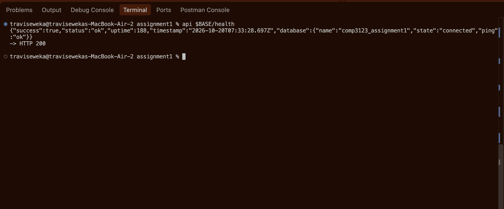 | `01-health.png` |
| 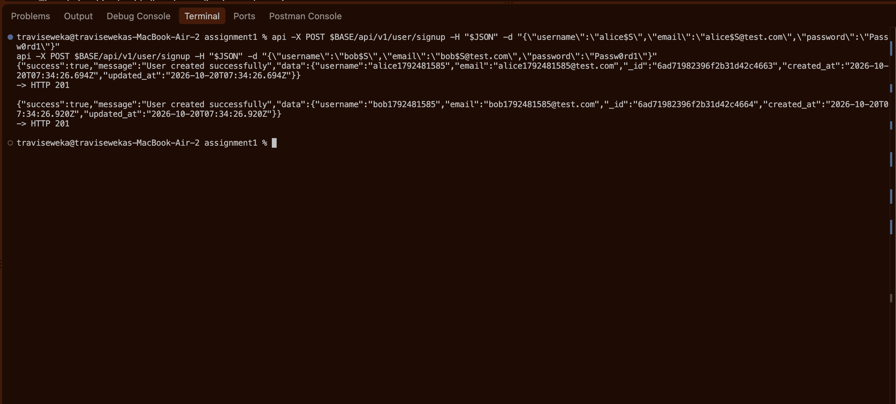 | `02-signup-201.png` |
| 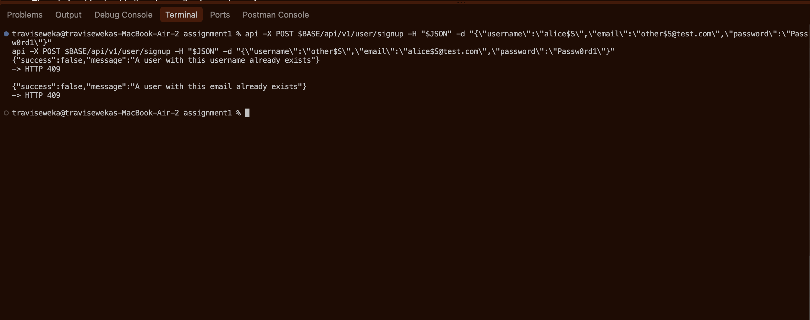 | `03-signup-409.png` |
| 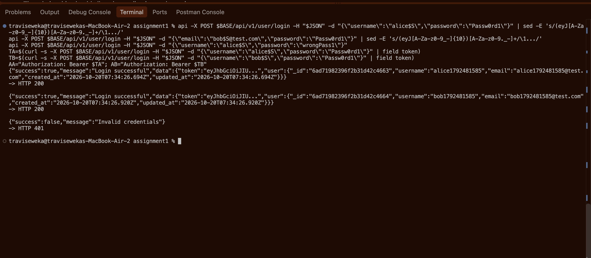 | `04-login-jwt.png` |
| 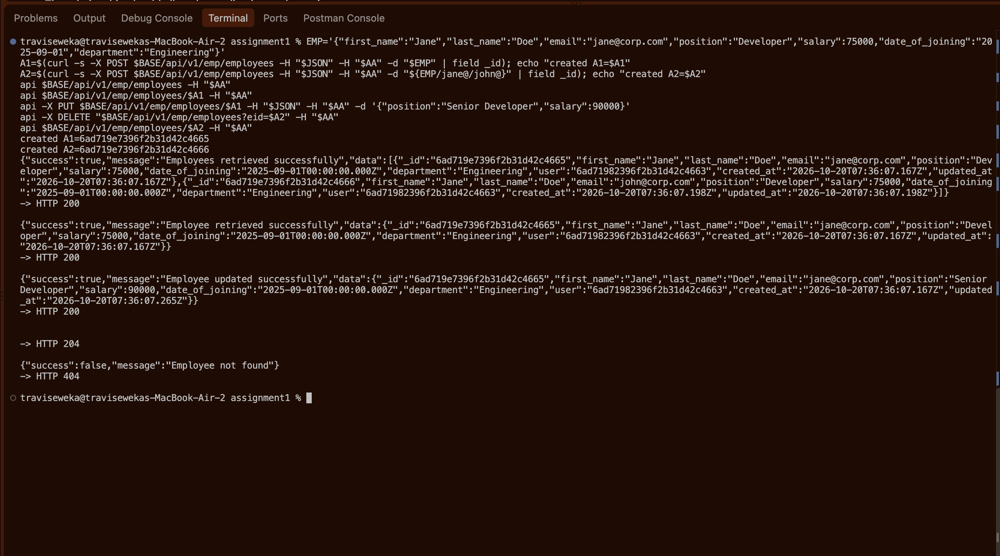 | `05-employees-crud.png` |
| 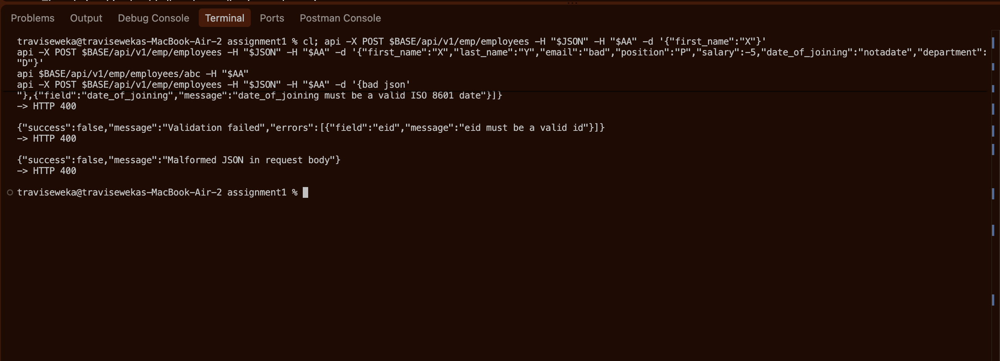 | `06-validation-400.png` |
| 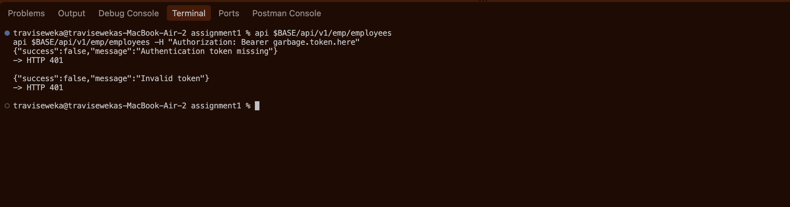 | `07-no-jwt-401.png` |
| 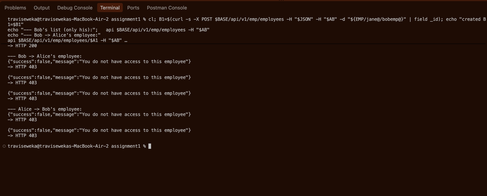 | `08-ownership-403.png` |
| 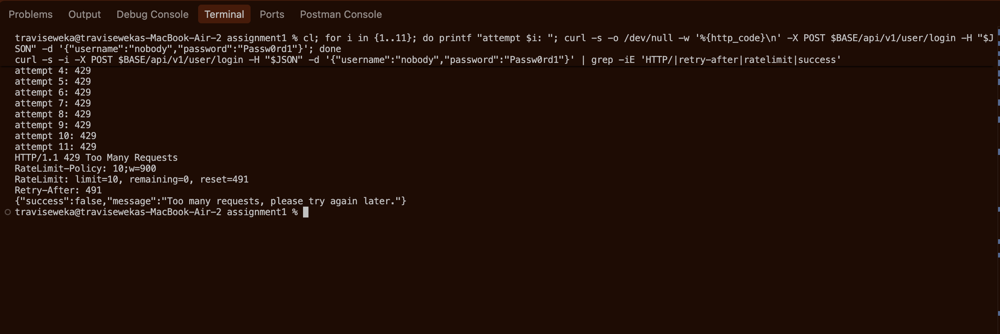 | `09-rate-limit-429.png` |
| 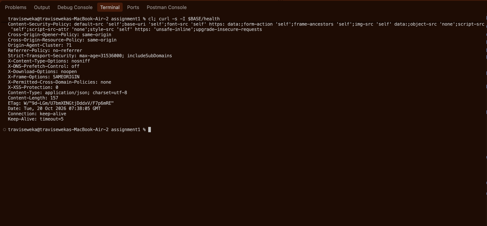 | `10-helmet-headers.png` |
| 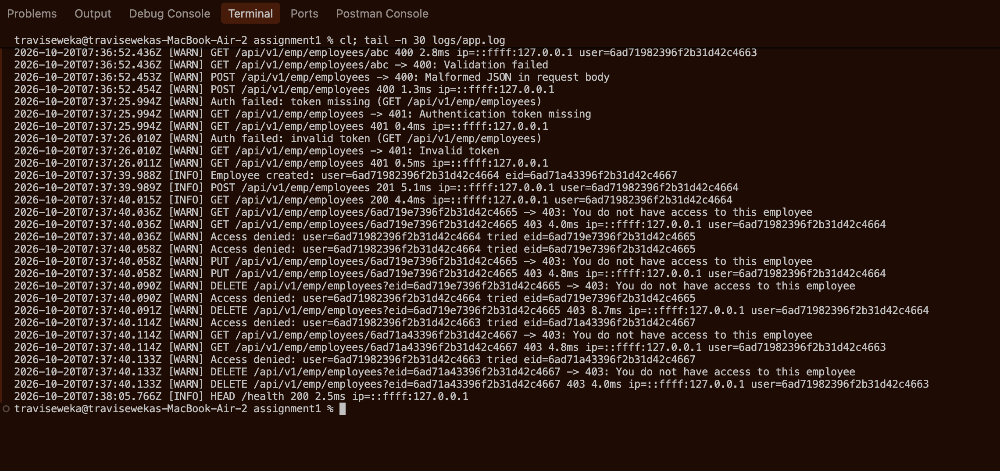 | `11-logs.png` |
| 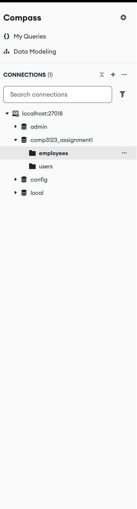 | `12-compass-database.png` |
| 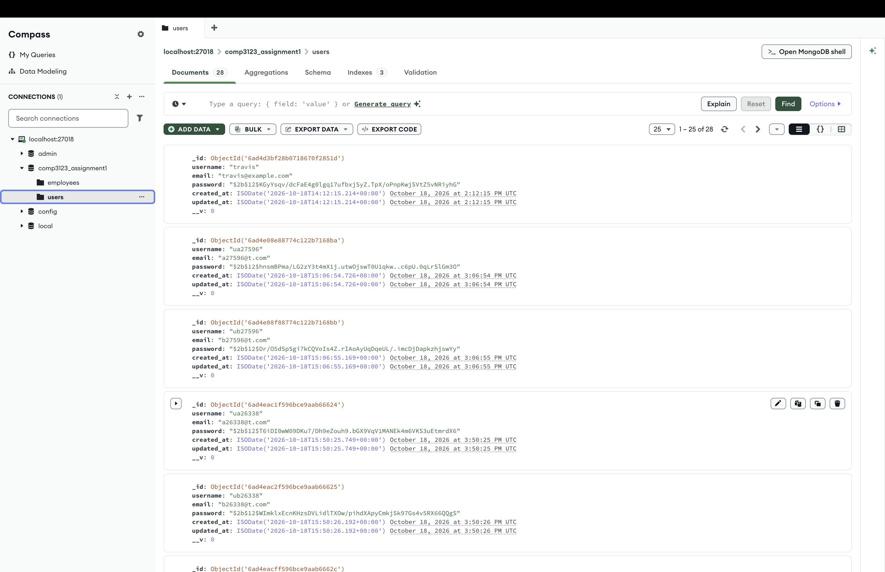 | `13-compass-users-hashed.png` |
| 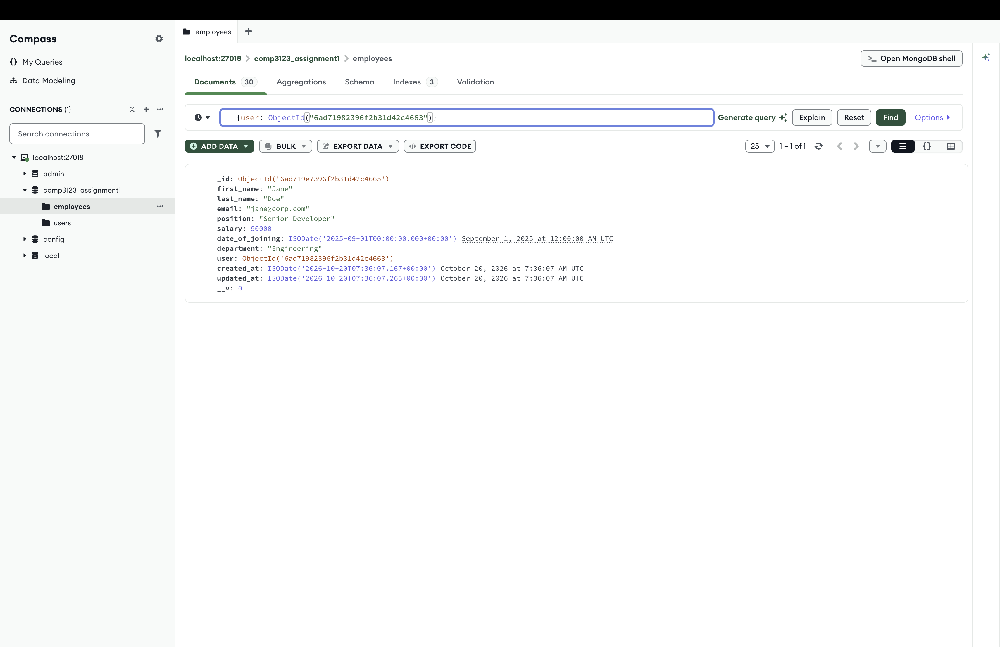 | `14-compass-employees-owner.png` |
| 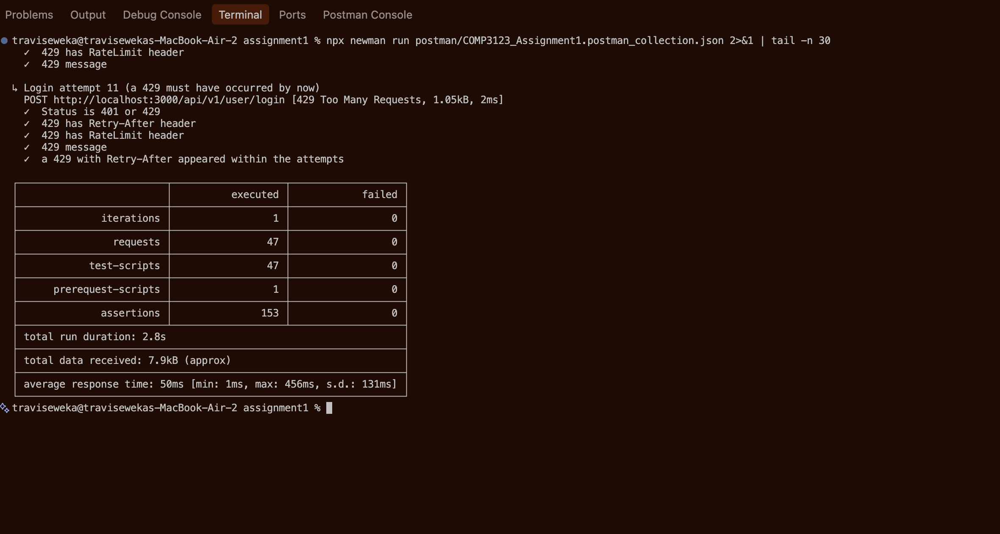 | `15-newman-run.png` |
